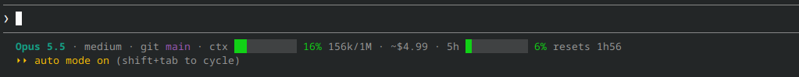

# claude-statusline

A compact, colored status line for [Claude Code](https://code.claude.com/docs/en/overview)
that shows what `/usage` tells you without typing it:



With every segment on:

```
Opus 5.5 · high · git main · ctx ████░░░░░░ 42% 84k/200k · ~$1.23 · cache 4m · +120 -34 · up 25m · 5h ████████░░ 83% resets 2h10 full in ~34m · 7d ██████░░░░ 55% resets 3d11h
```

| Name       | Looks like                                   | Meaning                                                         |
|------------|----------------------------------------------|-----------------------------------------------------------------|
| `model`    | `Opus 5.5`                                   | current model                                                   |
| `effort`   | `high`                                       | reasoning effort (only for models that support it)              |
| `branch`   | `git main`                                   | git branch of the session's directory, or commit if detached    |
| `context`  | `ctx ████░░░░░░ 42% 84k/200k`                | context window used: bar, percentage, tokens used / window size |
| `cost`     | `~$1.23`                                     | session cost at API prices (see below)                          |
| `cache`    | `cache 4m`                                   | time before the prompt cache expires (see below)                |
| `lines`    | `+120 -34`                                   | lines added / removed in this session                           |
| `duration` | `up 25m`                                     | time since the session started                                  |
| `5h`       | `5h ████████░░ 83% resets 2h10 full in ~34m` | 5-hour limit used: bar, percentage, reset, forecast (see below) |
| `7d`       | `7d ██████░░░░ 55% resets 3d11h`             | weekly limit used: bar, percentage, reset, forecast (see below) |

Percentages are green below 50 %, yellow from 50 %, red from 80 %.
A segment is hidden when Claude Code does not provide its value, for example
the usage limits when you log in with an API key rather than a Pro/Max plan.
You choose which segments to show, and in which order: see
[Choosing segments](#choosing-segments).

## Requirements

- bash 4+
- [jq](https://jqlang.org/download/)
- Claude Code with status line support (tested on 2.1.319)

## Install

```bash
git clone https://github.com/Spacekillerz/claude-statusline.git
cd claude-statusline
./install.sh
```

The installer asks, segment by segment, what you want to see (Enter keeps it,
`n` hides it). It then sets `statusLine` in `~/.claude/settings.json` (or
`$CLAUDE_CONFIG_DIR/settings.json`) to the `statusline.sh` of this checkout,
after saving a timestamped backup next to it. A `git pull` updates the status
line in place; run the installer again to change your choice.

By default the line is also redrawn every 60 seconds, so the countdowns
(`resets 2h10`, `cache 4m`, `up 25m`) keep moving while you read or think.
Without it, Claude Code only redraws the line after each message.

| Command                                | Effect                                        |
|----------------------------------------|-----------------------------------------------|
| `./install.sh`                         | asks which segments to show                   |
| `./install.sh --segments context,cost` | shows only these, in this order, no questions |
| `./install.sh --all`                   | shows every segment, no questions             |
| `./install.sh --refresh 30`            | redraws every 30 seconds instead of 60        |
| `./install.sh --refresh 0`             | redraws only after each message               |
| `./install.sh --uninstall`             | removes the status line                       |

Prefer to do it by hand? Add this to `~/.claude/settings.json`:

```json
{
  "statusLine": {
    "type": "command",
    "command": "/path/to/claude-statusline/statusline.sh --segments model,context,cost",
    "padding": 0,
    "refreshInterval": 60
  }
}
```

## Choosing segments

Pass a comma-separated list of segment names (see the table at the top),
in the order you want them:

```bash
statusline.sh --segments context            # ctx ████░░░░░░ 42% 84k/200k
statusline.sh --segments model,context,cost # Opus 5.5 · ctx ████░░░░░░ 42% 84k/200k · ~$1.23
```

Without `--segments`, the list comes from `CLAUDE_STATUSLINE_SEGMENTS`, and
without that, every segment is shown. Unknown names are ignored.

## Configuration

Set these in your shell profile, or in the `env` block of `settings.json`:

| Variable                          | Default | Effect                                         |
|-----------------------------------|---------|------------------------------------------------|
| `CLAUDE_STATUSLINE_SEGMENTS`      | all     | segments to show, in order                     |
| `CLAUDE_STATUSLINE_WARN`          | `50`    | percentage where a gauge turns yellow          |
| `CLAUDE_STATUSLINE_CRIT`          | `80`    | percentage where a gauge turns red             |
| `CLAUDE_STATUSLINE_FORECAST_FROM` | `70`    | percentage from which the forecast can appear, |
|                                   |         | `101` turns it off                             |
| `CLAUDE_STATUSLINE_SEP`           | ` · `   | separator between segments                     |
| `CLAUDE_STATUSLINE_BAR_WIDTH`     | `10`    | cells in each bar, `0` hides every bar         |
| `NO_COLOR`                        | unset   | any value disables colors                      |

## About the cost

Claude Code reports `cost.total_cost_usd` for the current session, computed at
API prices. On a Pro or Max subscription, you are not billed that amount: it is
an estimate of what the session would cost through the API, hence the `~`. The
`5h` and `7d` gauges are what counts against your plan.

## Limit forecast

Once a limit passes 70 %, the status line checks whether you would run out
before it resets, at the pace you have kept since the window opened. If so, it
adds `full in ~34m` in red. If the reset comes first, nothing is added: there
is nothing to worry about.

## Prompt cache

Each message sends Claude the whole conversation again. Anthropic keeps the
part it has already read in a cache for a few minutes (or an hour, depending
on your setup). While it is warm, Claude reads the conversation from the cache:
replies start faster and cost less. Once it expires, the next message
reprocesses the whole context from scratch, which is slower, especially with a
large context.

`cache 4m` tells you how long you can step away before that happens, `cache
cold` that it already has. The segment appears after the first reply.

## How it works

Claude Code runs the status line command after each message, and every 60
seconds with the installer's default, and writes the session state as JSON on
its stdin (model, effort, context window, cost, rate limits, prompt cache…).
`statusline.sh` extracts the fields with a single `jq` call, asks `git` for
the branch (read-only), and prints one line. Nothing is sent anywhere and no
API is called.

To see the raw JSON your version sends, point `statusLine.command` at
`tee /tmp/statusline.json` for one message.

## Tests

```bash
tests/run.sh
```

## License

[MIT](LICENSE)
